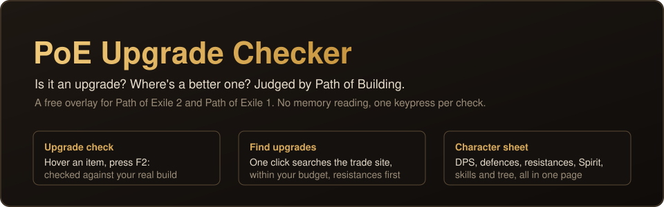
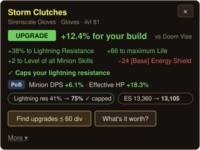
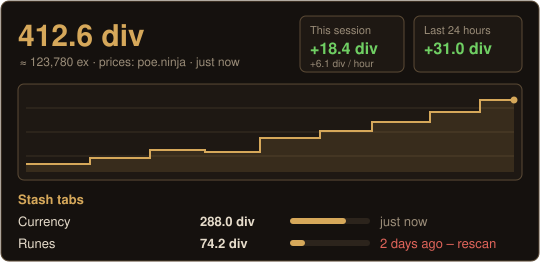

  
  
  

**PoE2 Upgrade Checker** is a small overlay that sits in your system tray while you play Path of Exile 2. It answers three questions in game:

| | |
|---|---|
| **Is this an upgrade?** Hover an item and press **Ctrl+D**. A popup gives it a gear score for your build and compares it with what you're wearing in that slot, stat by stat. |  |
| **Where's a better one?** One click searches the official trade site for gear with your item's stats or better, within your budget. If nothing turns up, it loosens the search for you. Results open in the app, scored against your gear, with a ready-made whisper. | |
| **What's my stash worth?** Open a currency, essence, rune or other specialty tab and press **Ctrl+Shift+S**. The app reads the tab from your screen and prices it with poe.ninja. It tracks your net worth, profit per hour and every change between scans. |  |

The pictures are illustrations of the app's popup and Stash value tab.

## Download

1. Get **`PoE2-Upgrade-Checker-Setup-x.y.z.exe`** from the [latest release](https://github.com/ets-public/poe2-upgrade-checker/releases/latest) and run it. It installs for your Windows user only, so no admin rights are needed, and **updates itself**.
   - Prefer no install? Use the **Portable** .exe from the same page. It doesn't auto-update.
   - Windows may warn about an unrecognised app because the installer isn't code-signed. Click *More info → Run anyway*.
2. In PoE2, go to **Options → Graphics** and set **Windowed Fullscreen**, so the overlay can draw over the game.
3. Hover an item and press **Ctrl+D**. The first-run guide walks you through saving your gear (or importing it from Path of Building).

## Features

- **Gear score for your build:**
  - Built in: the *Disciple of Varashta – Djinn summoner (ES)* build, plus an ES spellcaster and a Life + res build.
  - Tune how much each stat matters with the gear score editor.
  - Resistance caps are understood: extra fire res when you're capped scores nothing.
- **Upgrade popup:** UPGRADE / SIDEGRADE / DOWNGRADE, the change in every stat, open prefixes and suffixes for crafting, and *What's it worth?*
- **Trade search:**
  - *Same stats or better*, *by my weights*, *craftable bases*, or a custom search built from any of the trade site's ~3,600 stats.
  - Price range in divines (or exalts, using poe.ninja's live rate), ignored and excluded stats, and saved searches with **new-listing alerts**.
- **Your gear:**
  - Every slot, including weapon swap, jewels, flasks and charms.
  - Import from Path of Building (pobb.in links or codes).
  - Several characters, each with their own gear and build.
- **Stash value:**
  - **Tabs read from your screen:** currency, essence, runes, soul cores, omens, delirium, breach, expedition, abyss, fragments and idols, at any resolution.
  - **Everything else:** your trade listings and items you add from the popup.
  - **Tracking:** net worth chart, session profit per hour, 24 h change and a feed of what changed.
- **Built for playing:**
  - Compact popup.
  - Pin it to the cursor or a screen edge.
  - Text size and colour-blind options.
  - Starts with Windows.

## Fair play and privacy

- **Nothing touches the game:**
  - It never reads game memory and never injects anything.
  - Its only input to the game is **one Ctrl+C per hotkey press**, the same as copying an item yourself.
  - The stash reader looks at one screenshot of your screen, only when you press the scan hotkey.
- **Where data goes:**
  - It talks to the official trade site (pathofexile.com) and poe.ninja, nothing else.
  - Your gear, settings and stash history stay on your PC, in `%APPDATA%\poe2-upgrade-checker`.
- **Signing in is optional** and only used for *Travel to hideout*. You sign in on pathofexile.com's own login page, and the app only keeps the resulting login cookie, on your PC.
- **Not affiliated:** this is a fan-made tool, not affiliated with or endorsed by Grinding Gear Games.

## Why the stash reader works from the screen

Path of Exile 2 doesn't have a stash API yet: GGG's developer docs list the account stash endpoints as *PoE1 only*. So instead of asking for your session cookie (which GGG advises against), the app reads specialty tabs from a screenshot:

1. It works out which tab is open from the layout of its cells.
2. It reads each stack count with digit templates that adapt to your screen.
3. A count it can't read safely is marked *unreadable* and keeps its last value. It never guesses.
4. Hover a stack and press **Ctrl+C**, and the exact stack size from the game corrects it.

---

# Guide

## First-time setup

The **setup guide** opens on first run. You can reopen it from **My gear → Setup guide**.

1. **Import from Path of Building** (fastest). Paste a pobb.in link or a PoB code under *My gear → Import from Path of Building*. This fills every slot, your tree jewels and your resistances. PoB doesn't store base Armour/ES, so copy your armour pieces in game once for exact scores. Items you've already copied from the game are kept.
2. **Or copy each item:** open your character screen, hover each item, press **Ctrl+D**, then click **Set as …** in the popup. The checklist shows which slots are still missing.
3. Check **Resistances** on My gear: your totals and cap. Then the gear score knows when extra resistance is wasted.
4. Pick your build under **Build & weights**. The default is Djinn summoner.

**Characters:** the selector on My gear keeps separate gear, build and resistances for each character.

## The popup

- **Verdict:** UPGRADE, SIDEGRADE or DOWNGRADE, decided by the **gear score** change for your build, e.g. "-11 gear score vs Doom Vise". If you turn the build off, it uses your stat weights.
- **Compact view:** you see the top changes and two buttons, **Find upgrades** and **What's it worth?**. Click **More** for the full change table, Set as …, Items like this one, By my weights, Craftable bases and Custom search. Options → Popup can make **Full** the default.
- **Craft info:** with *advanced item descriptions* turned on in game, the popup shows open prefixes and suffixes, e.g. "Open: 2 prefixes, 2 suffixes – craftable".
- **Uniques:** you get *What's it worth?* and *Find cheaper copies*. **Unidentified** items aren't rated.
- While the game copies, the popup shows "Reading item…". If you press **Ctrl+C** yourself on something that isn't gear (currency, gems), no popup appears.
- **Options → Popup:** position (next to the cursor, left, right or top of the screen), text size, a colour-blind palette (blue and orange), and prices shown in both units, e.g. "220 ex (≈0.3 div)".

## Finding upgrades

- **Find upgrades for your <slot>** (in the popup, or on the My gear tab) searches for **the same stats or better** than your *equipped* item. Every mod becomes a filter with your value as the minimum, and one may be missing if the item has 4 or more.
  - If nothing is listed, it loosens the search automatically, to 90%, then 80%, then 65% of your values with more stats allowed missing. It tells you which level found listings.
  - Rune and enchant bonuses are left out, because you can socket your own. Base Armour/Evasion/ES/Spirit are worked out without the rune bonus, then set to 90%.
  - Uniques are searched by name.
  - For rings it searches against your weaker ring.
- **Craftable bases** (popup → More) finds rare, uncorrupted bases of the same type with your two most important stats rolled high and at least one open prefix and suffix, so you can craft the rest.
- **Items like this one** (in the popup, when you copied something that isn't equipped) does the same for the item you just copied.
- **By my weights** finds anything that scores higher with your stat weights, even if its stats are different. Your weights need to match your build for this to be useful.
- **Custom search…** opens the Find upgrade tab with the item from the popup:
  - untick stats you don't want, change the minimums or set them all to 90% / 80% / 70%, and add any trade-site stat
  - rune mods appear unticked
  - then click **Search with ticked stats**.
- The Find upgrade tab lists your equipped items and the items you copied recently. When you copy a new item, it switches to it unless you've edited the current search; in that case a notice offers to show it.
- **Ignored stats** (Search settings tab): tick e.g. *All resistances* if you don't want them to count.
  - **Ignore** leaves them out of the popup's score and change list, and out of every search.
  - **Exclude listings with it** also hides trade listings that have them.
  - You can ignore any single stat too: type it in, or click **⊘** next to it in the popup.
- **Stat database:** the **Browse stats…** buttons (Custom search, Ignored stats, Build & weights) open a searchable list of every stat the PoE2 trade site knows, about 3,600 of them.
  - Filter by kind: totals across all sources, explicit, implicit, rune, desecrated and so on.
  - Filter to **Seen on <item type>**: the stats that have appeared on that kind of item you've copied. The list grows as you copy more items.
  - From the list you can add a stat to a custom search (with a minimum), ignore or exclude it, or give it a weight.
- **Sellers:** the default is *Instant Buyout + In Person*. "In Person (online) only" leaves out merchant listings, which are most of the market.
- When a search finds nothing, the browser isn't opened. You get a hint and an *Open on trade site anyway* link instead.
- **Price range:** in the Search settings tab, set e.g. "from 5 to 20 Divine Orbs". The minimum filters out cheap junk listings; leave either end empty for no limit. It applies to every search, and the popup's button shows the range.
  - The Divine→Exalted rate is fetched automatically from poe.ninja (current league, refreshed hourly), so listings priced in exalts are included too. Untick **Auto** to type your own rate.
- The league defaults to the current challenge league. Change it in the Search settings tab and it stays remembered.

## Gear score (for your build)

Every item gets a **gear score from 0 to 100** for how useful it is to your character, with a grade: **S** 85+, **A** 70+, **B** 55+, **C** 40+, **D** below that. The built-in build is **Disciple of Varashta – Djinn summoner (ES)**:

- **Weapon / focus / amulet / helmet:** + Level of all Minion Skills.
- **Sceptre:** Spirit and ally damage.
- **Body armour and amulet:** Spirit.
- **Armour pieces:** Energy Shield.
- **Rings:** minion damage and crit.
- **Boots:** movement speed.
- **Everywhere:** resistances, life, mana and Intelligence.

Each slot is scored only on stats that can roll there. A perfect item for that slot is about 100, and stats your build doesn't use add nothing.

- **Popup:** shows the item's score next to yours, e.g. "45 C · Gear score · yours 56 (-11)". Click **why?** for the stats that scored, how good each roll is, what's missing, and which mods are useless to you.
- **Results window:** every listing shows its gear score, and you can sort by **Best gear score**.
- **My gear tab:** shows each slot's score, your **overall gear score**, and **Upgrade first:** your three weakest slots. Click one to search for an upgrade.
- Stats you've set to ignore don't count. Uniques and unidentified items aren't rated.
- **Resistance caps:** resistance only counts up to your cap. If you're already capped on fire, fire res on a new item scores nothing, and **why?** says so.
- **Jewels, weapon swap:** jewels (6 slots), Weapon 2 and Offhand 2 are tracked and scored too. Open *Weapon swap, flasks, charms & jewels* under the slot list on My gear. The overall score uses main gear only.
- **Build & weights tab:** choose a build (**Djinn summoner**, **ES spellcaster**, **Life + res**, or off) and use the **gear score editor**: for each stat, set 0× to 3× how much it matters to you. *Reset* undoes it.

## Stash value

Shows what everything you own is worth, in divines, and how that changes over time. It's on the **Stash value** tab, and the tray has *Scan stash tab* and *Stash value…*.

PoE2 has no stash API yet: GGG's developer docs list the stash endpoints as PoE1 only. So the app combines four sources:

1. **Specialty tabs, read from your screen.** Open Currency, Essence, Runes, Soul Cores, Omens (Ritual), Delirium, Breach, Expedition, Abyss, Fragments, Idols or Augments in game and press **Ctrl+Shift+S** (changeable).
   - The app takes one screenshot, works out which tab it is from the arrangement of its cells, and reads every stack count.
   - It works at any resolution and UI scale. The first scan on a new screen size takes a few seconds while it finds the scale; after that, about a second.
   - It never reads game memory and never sends keys.
   - A count it can't read safely is marked *unreadable* and keeps its last value. It never guesses.
   - **Wrong count?** Hover that stack and press **Ctrl+C**. The app reads the exact stack size from the game and fixes it. That also teaches it the name of any slot it didn't know.
2. **Your trade listings.** Enter your account name (Name#1234) and click *Refresh listings*.
   - Uniques and currency stacks count at market price. Other items count at your asking price.
   - A stack that is also in a scanned tab isn't counted twice.
3. **Other items** (gear and uniques in normal tabs): click **Add to stash value** in the item popup (More ▾).
   - Uniques follow poe.ninja.
   - Other items use your latest *What's it worth?* result, or a price you type.
4. **Prices** come from poe.ninja, refreshed hourly. Currency-type items are priced from the in-game Currency Exchange, uniques from trade listings. Items without a price are listed, not guessed. Uniques with only a few listings are flagged.

What you get:

- the total in div (and ex)
- a chart of your net worth over 24 h, 7 days, 30 days or all time
- each tab's value and share
- stale-tab warnings
- session profit and **profit per hour**, plus the change over the last 24 hours. Scanning a tab for the first time, or editing by hand, isn't counted as profit.
- a feed of every change between scans, e.g. "+3 Divine Orb (+3 div)"
- CSV export
- *Don't count* for any tab, or for your listings

How it compares with other tools:

- **poe2-stash-tracker** (screen reading, where the layouts come from): needs Python and a 2560×1440 screen at the default UI scale. It treats a missed reading as a change. This app needs neither, keeps last values for unreadable counts, learns your screen's digits, and fixes counts with Ctrl+C.
- **poe2stash / StashSage**: only see your trade listings. Here, listings are one of four sources.
- **PoeStash, Exilence**: need the official stash API, which PoE2 doesn't have yet.

## Trade results in the app

Searches show their listings in a **results window** (always on top, on the right of your screen) instead of the browser:

- Each listing is scored against your equipped item: **UPGRADE +38 (+12%)**, with the stat changes underneath.
- **Sort** by best upgrade, **best value** (upgrade points per divine spent), cheapest, or the trade site's order. Tick **Upgrades only** to hide the rest.
- **Copy whisper** puts the seller's message on your clipboard; paste it in game chat (Enter, Ctrl+V, Enter).
- Instant Buyout listings have **Buy on trade site**, with their position on the page.
- **Load 10 more**, **Open on trade site**, and **☆ Save search**.
- Prices in any currency are converted with poe.ninja rates, so 300 ex and 1 div compare correctly.
- Prefer the browser? Untick *Show trade results in the app* in Options. If the listings can't be loaded, it opens the browser on its own.

## More

- **What's it worth?** (popup) looks up listings like the copied item, ignoring your price range and ignored stats. It tells you the cheapest and typical price, e.g. "Worth about 2 div (cheapest 180 ex, 12 similar listed)", and shows them cheapest-first.
- **Saved searches** (Find upgrade tab): run a saved search again with one click. It shows how many are listed now, e.g. "31 listed (+6 since last time)".
- **Alerts:** tick **Alert** on a saved search and choose how often to check (Find upgrade tab). New listings give a Windows notification, e.g. "3 new listings: … Cheapest new: 220 ex · gear score 47 C". Click it to see them. Checks are spaced out to respect the trade site's rate limits.
- **Results window:** Esc hides it, and **Ctrl+Shift+D** (changeable in Options) shows it again. It remembers its size and position.
- **Sign in (optional, experimental):** Options → Account opens the pathofexile.com login inside the app. Once signed in, Instant Buyout listings get a **Travel to hideout** button. This uses an unofficial endpoint, so if it fails, use *Buy on trade site* instead.
- **Suggest from my gear** (Build & weights tab) builds weights from your equipped items. Each stat's typical roll is worth about 30 points, more if several items have it. It skips uniques, rune bonuses and local defence mods that [Base] already covers. Use the suggestions as they are or only add missing ones; there's an Undo.
- **Options → Results & startup**: start with Windows (quietly in the tray), and choose whether this window opens on start.

## Hotkey & troubleshooting

- Change the hotkey under Settings → Options. Click the box, press your keys, then click Save.
- **Show a test popup** checks that the overlay can draw at all.
- **Open log file** shows what happened on each press. It's also in the tray menu.
- Nothing happens in game? Check the tray menu says "Hotkey: Ctrl+D", that PoE2 is in Windowed Fullscreen, and what the log says.
- If the game misses the first Ctrl+C, the app tries once more automatically.
- The popup closes when you move the mouse away from it, when you click ×, or after the time set in Options. Esc is left to the game.

## Notes / limits

- Flasks and charms can be saved but aren't scored.
- Two-handers are compared against your weapon plus offhand together.
- Your data lives in `%APPDATA%\poe2-upgrade-checker`.

## Dev

- `npm test` runs the parser, scorer, trade-query, stash reader (synthetic screenshots at several resolutions) and ledger tests.
- `src/stash/assets/` holds the tab layouts, frame crops and digit templates from [poe2-stash-tracker](https://github.com/turlockmike/poe2-stash-tracker) (MIT, see `LICENSE-poe2-stash-tracker`).
- `build-exe.bat` (or `npm run dist`) builds the installer and the portable .exe locally, without publishing.
- **Releasing a new version:** bump `version` in `package.json`, then double-click `release.bat`. You need [Git for Windows](https://git-scm.com/download/win) installed once. The script pushes to GitHub and tags the version. GitHub Actions then builds on Windows, runs the tests and publishes the release, and installed copies pick it up within a few hours. You can also start a build from **Actions → Release → Run workflow**.

## Credits

- Stash tab layouts, frame crops and digit templates: [poe2-stash-tracker](https://github.com/turlockmike/poe2-stash-tracker) (MIT).
- Prices: [poe.ninja](https://poe.ninja). Trade data: the official [Path of Exile trade site](https://www.pathofexile.com/trade2).
- Path of Exile is a trademark of Grinding Gear Games. This project isn't affiliated with or endorsed by them.
